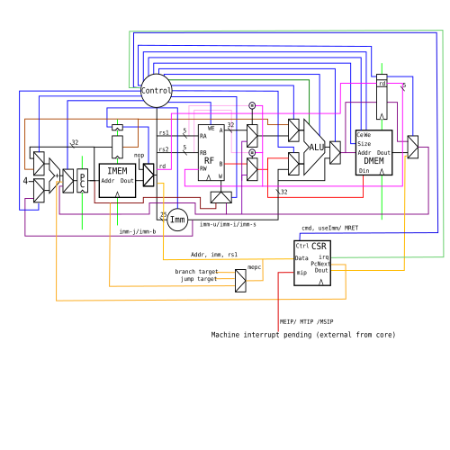
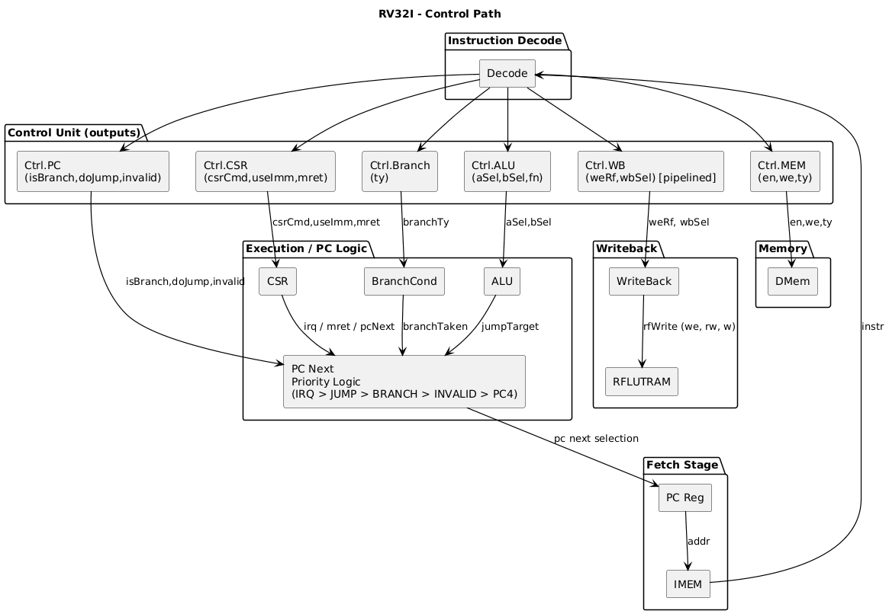

# RISC-V 32i Processor (Minimal Interrupt Support)

A Chisel implementation of a **RV32I** processor with minimal interrupt support.
Developed as part of the RISC-V academic project at **Ensimag - Grenoble INP**
under the supervision of **Olivier Muller** and **Frédéric Petrot**.

---

## Architecture Overview



The processor is organized as a **2-stage pipeline** (Fetch → Decode/Execute + WriteBack)
with a single bypass path to resolve RAW hazards.

### Pipeline Stages

| Stage | Modules | Description |
|-------|---------|-------------|
| **IF** | `Fetch` | PC management, instruction bus read, branch/jump/IRQ target selection |
| **ID/EX** | `Decode`, `ALU`, `BranchCond`, `CSR`, `DMem` | Decode, execute, memory access, CSR read/write |
| **WB** | `WriteBack`, `RFLUTRAM` | Register file write-back |

A pipeline register (`dataExReg`) propagates `{rd, value, csrData}` from EX to WB.
Branch/jump/IRQ resolution injects a NOP into the decode stage for the following cycle.

### Bypass

Single-cycle forwarding from WB to EX for `rs1` and `rs2`,
conditioned on `wbcontrolsReg.weRf && rfAddr == dataExReg.rd`.
MEM and CSR results are also forwarded via `WbMuxSel`.

---

## Top-Level System (`ZzTop`)

The full SoC instantiated for FPGA synthesis:

```
ZzTop
├── ClockGen          — PLL wrapper (pixel clock + system clock)
├── Rv32i             — RV32I core
│   ├── Fetch
│   ├── Decode (OpDecoder, TypeDecoder)
│   ├── ALU + BranchCond
│   ├── DMem
│   ├── CSR
│   ├── RFLUTRAM      — Register file (LUT RAM)
│   └── WriteBack
├── BusInterconnect   — Simple address-mapped bus (data bus)
├── IDMem             — Instruction + data memory (DPRAM)
├── CLint             — Timer (mtip) + software (msip) interrupts
├── Plic              — External interrupt controller (meip)
├── LedIp             — LED/button peripheral + IRQ source
└── VgaIp + IDMem     — VGA framebuffer (pixel clock domain)
```

### Memory Map (data bus)

| Peripheral | Description |
|------------|-------------|
| `IDMem` | Main memory (instructions + data) |
| `LedIp` | LED output, switch/button input |
| `CLint` | Core-local interrupt controller |
| `Plic` | Platform-level interrupt controller |
| `IDMem` (VGA) | VGA framebuffer |

---

## Interrupt Handling

Three interrupt lines feed into the `CSR` module:

- **meip** — external interrupt, routed through PLIC (source: `LedIp`)
- **mtip** — timer interrupt, from CLint
- **msip** — software interrupt, from CLint

PC selection priority: `IRQ/MRET > JUMP > BRANCH > INVALID > PC+4`

---

## Control Overview



---

## Dependencies

| Tool | Version | Purpose |
|------|---------|---------|
| JDK | ≥ 11 | Scala / Mill runtime |
| Scala | 2.13.16 | Language |
| [Mill](https://mill-build.org) | auto-downloaded | Build tool (`./mill` wrapper) |
| Chisel | 7.2.0 | HDL (fetched by Mill) |
| Verilator | any recent | Simulation backend |
| GTKWave | any | Waveform viewer |
| `riscv64-unknown-elf-gcc` | any | Cross-compiler for bench programs |
| Vivado | 2019.1 | Synthesis + bitstream generation |
| `djtgcfg` | any | Digilent JTAG programming tool |

Target FPGA: **Xilinx xc7z010-clg400-1** (Digilent Zybo board).

> **Vivado setup** — source the env before any `make` target that calls Vivado:
> ```sh
> source /path/to/Vivado/2019.1/settings64.sh
> ```

---

## Build & Simulate

```sh
# Download Mill wrapper (once)
make mill

# Compile all bench programs to .mem
make compile

# Run all tests in simulation
make autotest

# Run a specific test
make autotest PROG=morse

# Open GTKWave on a specific test (generates VCD)
make simulation PROG=morse CYCLES=5000
```

---

## Flash to FPGA

Steps: compile bench → generate bitstream → patch memory → program board.

```sh
# Source Vivado first
source /path/to/Vivado/2019.1/settings64.sh

# Full flow: generate bitstream + patch .mem + flash
make fpga PROG=<bench_name>
```

`PROG` is the filename without extension from the `bench/` directory.

Internally:
1. `RTL` — emits SystemVerilog from Chisel
2. `golden.bit` — Vivado full synthesis + place & route
3. `download.bit` — `updatemem` patches program memory into bitstream
4. `fpga` — programs board via Vivado + djtgcfg (Digilent Zybo detected over USB)

> Regenerating the bitstream takes ~10 min. If only the program changes,
> `golden.bit` is reused and only `updatemem` reruns (seconds).

---

## Demo Programs

| Program | Description |
|---------|-------------|
| `invaders` | Space Invaders on VGA display |
| `morse` | Morse keyboard via buttons, output on LEDs |
| `chenillard_rotation` | LED chaser (rotation) |
| `chenillard_minimaliste` | LED chaser (minimal) |
| `testirq` | Timer interrupt demo |
| `time_irq` | Timer-based periodic IRQ |

```sh
# Example: run Space Invaders on the board
make fpga PROG=invaders
```
